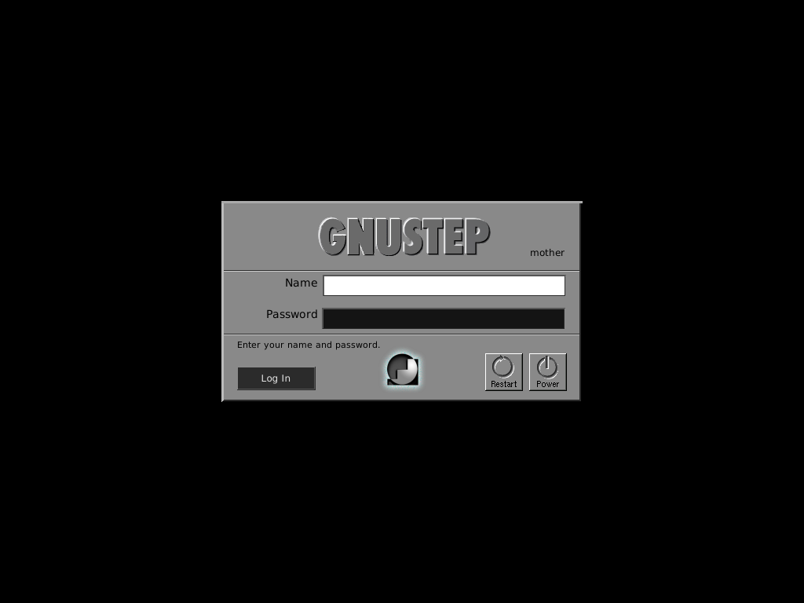

# loginpanel

Loginpanel.app is a graphical login manager for GNUstep systems.  It is
intended to serve the same role as xdm, gdm, or other display managers: start
or attach to an X display, present a greeter, authenticate a local user, start
the user's X session, clean up clients after logout, and return to the greeter.

The build also produces loginpaneld, a small supervisor suitable for launching
from init or a system service.  The supervisor restarts loginpanel if the
greeter exits unexpectedly.



## Build

Requires GNUstep Base, GUI and Make, an Objective-C compiler, X11/Xau development
libraries, and libcrypt (Linux). Build with `make -f GNUmakefile`.

For system deployment, use PAM and install its development headers first:

```
make -f GNUmakefile clean
make -f GNUmakefile have-pam=yes
```

PAM builds link directly to libpam; gscrypt is no longer required. Clean before
switching authentication backends. PAM uses the `loginpanel` service, verifies
account policy, establishes credentials, opens a session before launching the
desktop, and closes it at logout. Install a distribution-appropriate
`/etc/pam.d/loginpanel`; [packaging/loginpanel.pam](packaging/loginpanel.pam)
is an example for Debian/Ubuntu. Password changes and interactive MFA challenges
are not supported by this two-field greeter; expired passwords are rejected.

The default non-PAM build uses the system password database and crypt with the
complete stored hash. On Linux it checks shadow account/password expiry and
rejects empty or locked passwords. It does not implement the full PAM policy
stack and requires root access to read shadow passwords.

## Running

`make -f GNUmakefile install` installs the application and supervisor into your
configured GNUstep directories. Run `loginpaneld` as root from the system service
responsible for a **dedicated graphical login display**, with the GNUstep Tools
directories in PATH. Configure the service to stop its entire process group/cgroup
on shutdown. Do not enable it alongside another display manager on the same
seat. This repository does not automatically install or enable a system service.

`LOGINPANEL_DISPLAY` selects the display and takes precedence over `DISPLAY`:

```
LOGINPANEL_DISPLAY=:1 loginpaneld
```

An accessible existing display is reused. Otherwise an X server is started using
`DEFAULT_XSERVER` in `XServerManager.h`, with TCP disabled and a private X authority
cookie. The service must have permission to start X on the selected console/seat;
Xorg's console policy still applies. Attached displays must allow the greeter to
manage local-user access. The authenticated local user is granted access for the
session, and that grant is removed at logout; pre-existing grants are preserved.
Remote X sessions are not supported.

Enter a local username, press Return or Tab to reach the masked password field,
and press Return or click **Log In**. Failed authentication clears the password
and briefly throttles retries. Restart and shutdown require confirmation and root
privileges.

The session runs with the user's UID, GID, supplementary groups, home directory,
and a fresh environment plus PAM-provided variables. The first readable regular
script is run with `/bin/sh`, in this order:

1. `~/.xsession`
2. `~/.xinitrc`
3. `/etc/X11/Xsession`
4. `/etc/X11/xinit/xinitrc`
5. `/etc/X11/xdm/Xsession`

Use a script that keeps the desktop session in the foreground, for example
`exec /path/to/your/session-manager`. When it exits, the greeter cleans up its
process group, closes PAM, and becomes available again. Processes that deliberately
detach into another process group require the system's session/cgroup manager
for cleanup. No display-wide X-client kill is performed. Startup failures return
to the greeter with an error instead of hanging.

## Validation

On Linux, run `sh Tests/run.sh`. Tests use synthetic password records and an
isolated temporary session home; they do not modify system accounts. They check
password/hash handling, account rejection, privilege/environment setup, and
session failure exits and greeter recovery. With Xvfb installed and display `:99`
free, `sh Tests/run-xserver.sh` checks X cookie protection and server cleanup.
A real privileged PAM login and the target desktop should
also be tested on a dedicated seat before deploying as a system display manager.

## Change History
06/2026

Update loginpaneld so that it keeps respawning the
loginpanel once the user logs out.  Fix how loginpanel
interfaces with X to create a session.

11/2000

NSTextField commited to repository.  I need to wait
for further updates in the NSLayoutManager/
GSSimpleLayoutManager code before I can add the 
echoes bullets feature, but it works for now.

The only thing which needs to be done to make
the application of practical use is to find a 
way to install it so that it will work prior to
anyone being logged in to the machine.

10/2000

I am making some progress on the fixes for 
NSSecureTextField.  I believe I should have it 
working sometime soon.

8/2000

The application is getting closer and closer
to completion.  Authentication using PAM now works
under GNUstep on Linux.   It seems as though the
only real obstacle to getting it working completely
is the fact that NSSecureTextField doesn't work.

3/2000

This application is not ready for primetime yet.
It is mostly experimental at this stage.  The
reason I am releasing it now is to let those who
are interested play with it.

It seems to work under OPENSTEP4.2/Mach, at the
moment.  It does everything I expect it too.
It seems to only partially work under GNUstep.
I believe this has something to do with how
the gmodel file is being translated.

Gregory Casamento
